<p align="center">
  
</p>

<h1 align="center">Agent Office</h1>

<p align="center">
  Пиксельный офис, в котором видно, как работают агенты
  <a href="https://claude.com/claude-code">Claude Code</a> и <a href="https://openai.com/codex">Codex</a>:<br>
  кто сидит за столом, что делает прямо сейчас, кто сдал работу и сколько это стоило.
</p>

<p align="center">
  
  
  
  
</p>

<p align="center">
  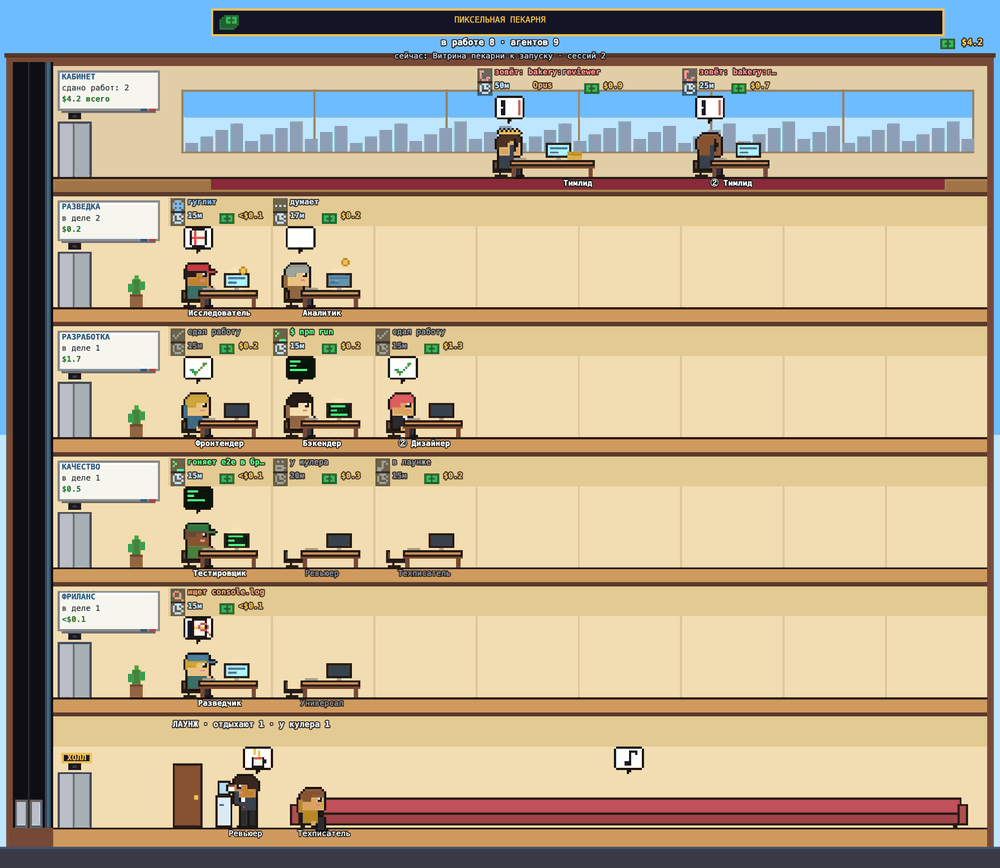
</p>

<p align="center"><sub>Двое сдали работу: галочка над столом, лифт, диван. Остальные работают.</sub></p>

Сервер читает журналы, которые Claude Code и Codex и так пишут в `~/.claude/projects` и `~/.codex/sessions`. Видны все сессии сразу: из терминала, из приложения, из любой папки. Хуки и плагины не нужны, в журналы ничего не пишется.

Обычные чаты claude.ai и ChatGPT сюда не входят: по ним нет ни токенов, ни трат.

## Быстрый старт

```bash
git clone https://github.com/miulyano/agent-office.git
cd agent-office
python3 server.py
```

Откройте http://localhost:8767. Ставить ничего не нужно: страницы собраны, серверу хватает стандартной библиотеки Python.

Офис в строке меню и автозапуск описаны в [Установке](#установка).

## Что внутри

| | Что это | Зачем |
|---|---|---|
| 🏢 | **Офис по этажам** | Все агенты сессии на одном экране, у каждого свой стол |
| 👀 | **Все сессии сразу** | Claude Code и Codex, из любой папки, без настройки |
| 💸 | **Деньги** | У каждого стола, по отделам, по сессии и за день |
| 📊 | **Статистика** | Траты и токены по дням, моделям, папкам и часам |
| 🤖 | **Живой штат** | Новый агент сам садится за стол рядом с коллегами |
| 🎨 | **Три офиса и время суток** | Уютный, Бизнес-центр, Лофт, от утра до ночи |
| 📸 | **Скриншот** | Здание целиком в PNG со смешным названием |
| 🍎 | **Строка меню macOS** | Траты за сегодня и лампочка «кто-то работает» |

## Что на экране

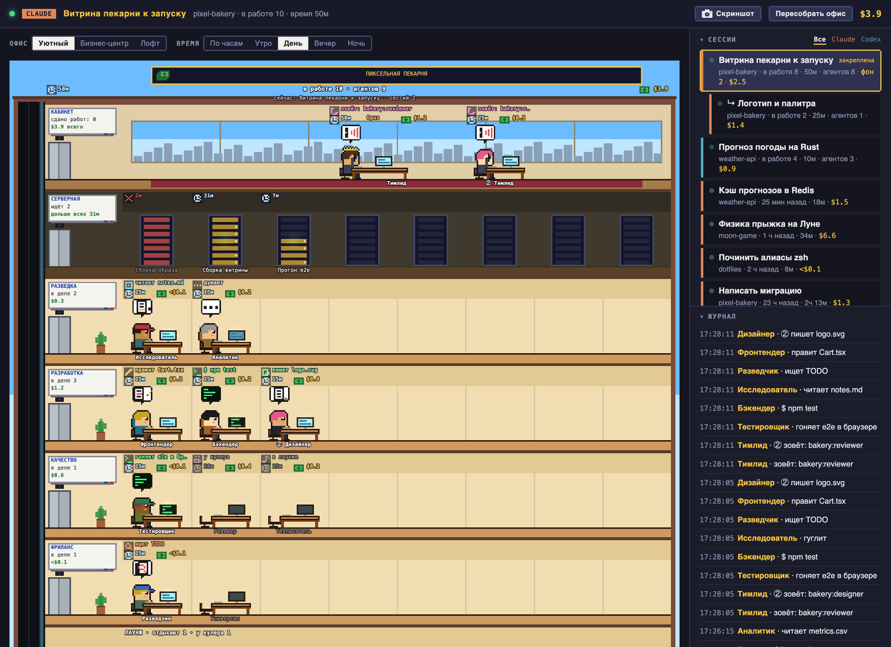

| Зона | Что там |
|---|---|
| **Шапка** | Чья сессия, название, папка, кнопки «Скриншот» и «Сгенерировать офис», итоговая сумма |
| **Переключатели** | Вид офиса и время суток |
| **Здание** | Наверху кабинет руководителя (главная сессия), ниже этаж на каждый отдел, внизу холл с лаунжем. Встроенные агенты (`general-purpose`, `Explore`, `Plan`, `claude`, `claude-code-guide`, `statusline-setup`) сидят на этаже «Фриланс», их столы живут как у остальных. Под каждым в лаунже подпись; у фрилансера с пометкой «фриланс» |
| **Задача из нескольких сессий** | Сессии, которые приложение Claude запустило из одной (новая задача, worktree), показываются в офисе родителя: их руководители сидят в том же кабинете, агенты на общих этажах. Клик по порождённой сессии открывает её собственный офис. Под крышей подпись, какая сессия сейчас работает, у людей из порождённых сессий метка с её номером (② первая порождённая), у корня метки нет. Связь сервер берёт из заметки «Linked sessions» в журнале родителя и из `~/.claude/sessions/*.json`; если родитель уже закрыт, дочерняя сессия пристаёт к последней сессии своей папки |
| **Сессии** | Всё за сутки, цветная полоса показывает, чья сессия. Порождённые сессии идут под родителем со стрелкой и веткой. Клик открывает офис, галочка «следить за активной» переключает его сам, фильтр «Все · Claude · Codex» оставляет одного провайдера |
| **Журнал** | Последние действия руководителя и агентов |

В ячейке агента: что он делает («правит cuts.json», «$ npm test»), часы (сколько работает, сколько заняло, с какого времени дома; у руководителя время текущего запроса: 45с, 28м, 1ч 05м), сколько потратил, облачко над головой, стол и имя. Модель видна по одежде (таблица ниже), подпись модели только в кабинете. Пустые отделы сворачиваются в полоску.

### Кто чем занят

Состояние берётся из журнала:

| С последней записи | Агент |
|---|---|
| меньше минуты | работает: печатает, над столом значок инструмента |
| до 3 минут | думает |
| до 10 минут | пьёт кофе у кулера в холле |
| дольше | спит за столом, через полчаса уходит домой |

Сдал работу: 15 секунд галочка над столом и папка едет пневмопочтой наверх, потом лифт и полчаса в лаунже, потом домой. В ячейке остаётся «дома с 18:40».

### Кто есть кто

Модель видна по одежде:

| Грейд | Claude | Codex | Одежда |
|---|---|---|---|
| Интерн | Haiku | Luna | кепка |
| Миддл | Sonnet | Terra | худи |
| Сеньор | Opus | Sol | костюм |
| Лид | Fable | Astra | тёмный костюм и очки |

### Деньги

Купюра и сумма у каждого стола, монетки летят к работающим, сумма отдела на доске этажа, итог на крыше.

Суммы посчитаны по ценам API, по подписке счёт другой. Цены лежат в таблице `PRICES` в `server.py`. Модель без цены (например, `codex-auto-review`) считается в токенах, но стоит $0.

## Вид

Три офиса и время суток: по часам или вручную.

| Уютный | Бизнес-центр |
|---|---|
| 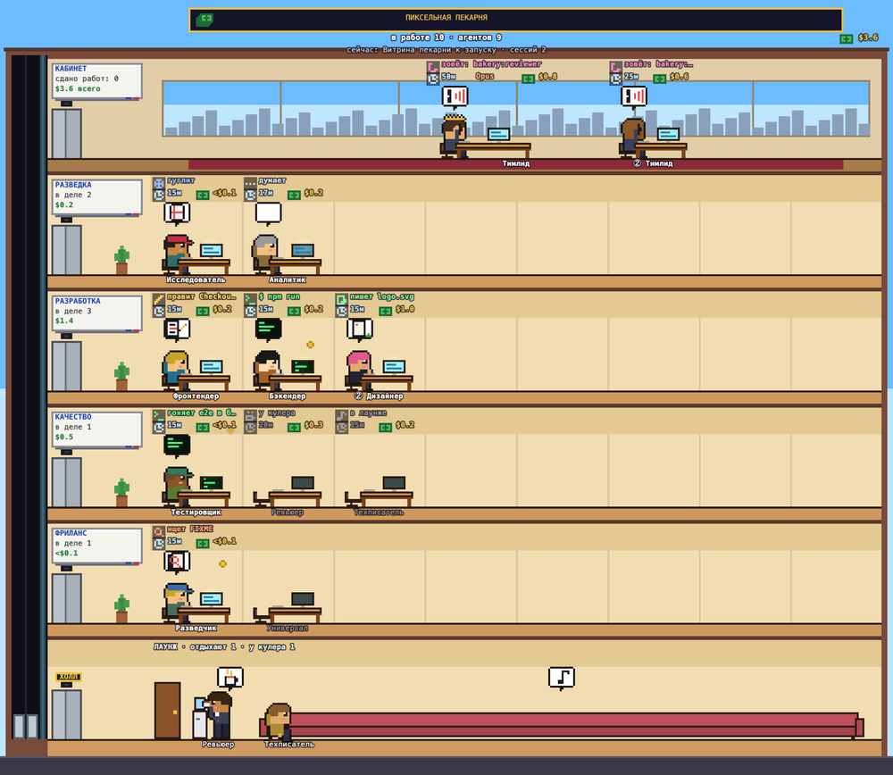 | 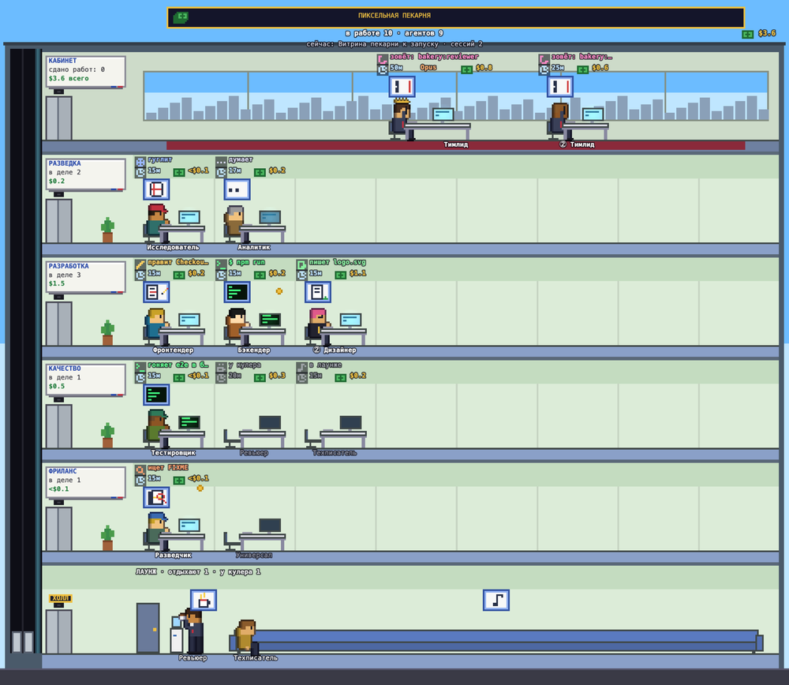 |

| Лофт | Ночь |
|---|---|
| 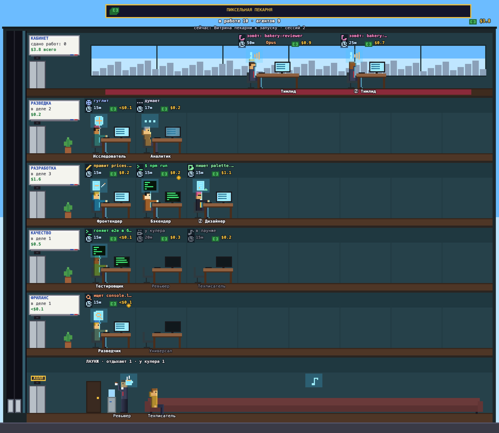 | 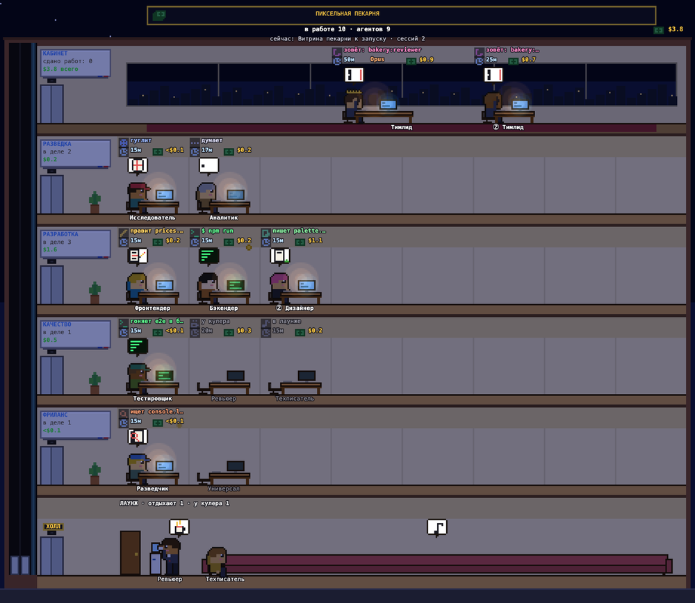 |

## Скриншот офиса

Кнопка с камерой снимает здание выбранной сессии целиком, даже если оно не влезает в окно. PNG с названием по настроению офиса («Все на кофе», «Кипит работа») ложится в `~/Pictures/Agent Office/` и в буфер обмена. Если сервер не смог записать файл, картинку скачает браузер.

## Codex

То же здание с голубой вывеской. Тред авторевью сидит за столом «Контролёр», запущенные агенты во фрилансе.

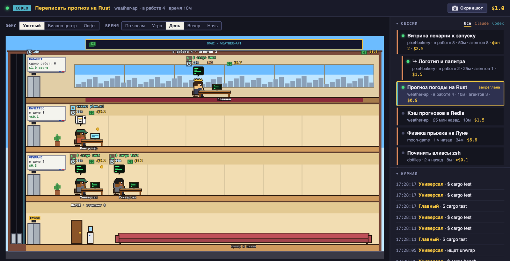

Старые журналы Codex сжаты, для них нужен `zstd` (`brew install zstd`). Без него видны только свежие.

## Строка меню (macOS)

В строке меню пиксельный офис, рядом траты за сегодня и зелёная лампочка с числом сессий, где кто-то работает. Клик открывает окошко.

| Сессии | Статистика | Токены |
|---|---|---|
| 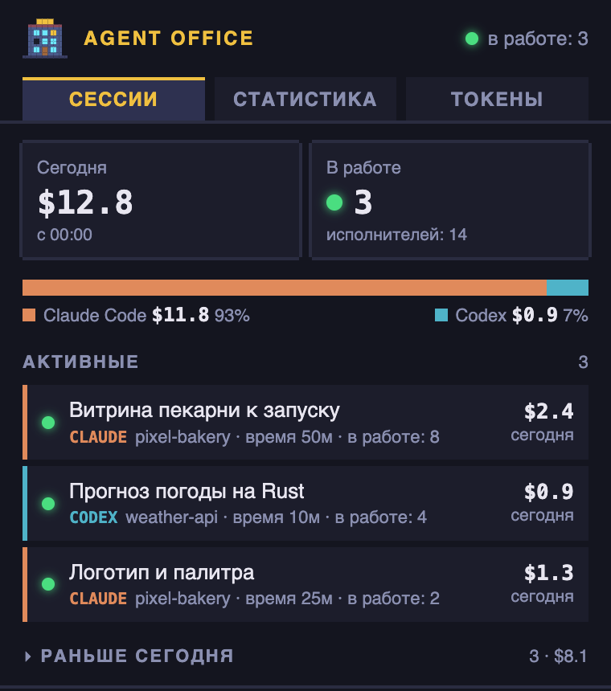 | 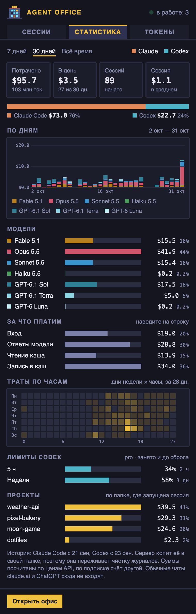 | 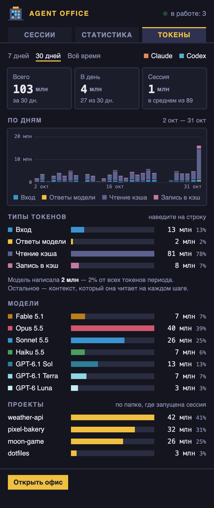 |

| Вкладка | Что там |
|---|---|
| **Сессии** | Траты с полуночи, кто сейчас в работе, активные и прошедшие сессии. Клик открывает офис |
| **Статистика** | 7 дней, 30 дней или всё время, по провайдеру: по дням и моделям, за что платим, карта по часам, лимиты Codex, папки |
| **Токены** | То же в токенах |

Правый клик: перезапуск сервера, лог, автозапуск, выход.

Историю трат сервер хранит у себя в `stats.json`, поэтому она переживает чистку журналов. Окошко это страница сервера, её можно открыть и в браузере: http://localhost:8767/menubar.html.

## Офисы папок

У каждой папки один штат и один офис. Сессия показывает столы тех, кого может позвать или уже звала.

Стол невызванной в этой сессии роли стоит пустым, с табличкой; человек садится при первом вызове.

**Штат** собирается без модели: из последней сессии папки и файлов агентов (плагины, `.claude/agents`, `~/.claude/agents`). Пока офиса нет, столы расставлены автоматически: отделы по роду работы, должности из словаря.

**«Сгенерировать офис»** отдаёт Claude (`claude -p`, Sonnet, без инструментов и ваших настроек) список агентов, их инструкции и историю вызовов. Это 10–30 секунд и несколько центов, потолок 50 центов. Сборку можно отменить. Если не вышло, офис остаётся прежним, появляется причина и «Повторить». «Вернуть прежний» откатывает.

**Новый агент садится сам.** Раз в 30 секунд сервер сверяет штат с офисом. Новичок получает стол рядом с коллегами по плагину, потом одна генерация уточняет его отдел и должность. Остальных она не трогает. Без офиса деньги сами не тратятся.

**При пересборке остаются** роль из файла агента (`# Роль`), прежние должности и закреплённые столы. Агенты общих плагинов сидят на этаже «Поддержка».

### Настройка руками

Офисы лежат в `~/.claude/agent-office/offices/<папка>.json`. Полный пример в [examples/office.example.json](examples/office.example.json).

| Поле | Где | Что делает |
|---|---|---|
| `title` | офис | Вывеска на крыше |
| `titleLocked` | офис | `true`: вывеска не меняется при пересборке |
| `auto` | офис | `false`: новые агенты не садятся сами |
| `lang` | офис | Язык подписей, `ru` или `en` |
| `zones[].id`, `zones[].name` | отдел | Раскладка держится на `id`, подпись в `name` |
| `desks[].type` | стол | Тип агента: `main` для руководителя, `плагин:имя` для остальных |
| `desks[].name`, `desks[].short` | стол | Должность и короткая подпись на столе |
| `desks[].prop` | стол | Предмет на столе: `magnifier`, `clipboard`, `tablet`, `box` и другие |
| `desks[].shirt`, `hair`, `skin` | стол | Внешность |
| `desks[].locked` | стол | `true`: стол не сдвинется и не переименуется |

То же можно задать из репозитория в `.claude/office.json`: `title`, `boss`, `zones` со столами. Манифест главнее модели.

## Установка

### Что нужно

| Что | Зачем | Обязательно? |
|---|---|---|
| Python 3.9+ | Сервер | Да |
| Браузер | Страница офиса | Да |
| Claude Code или [Codex](https://openai.com/codex) | Откуда брать сессии | Хотя бы один |
| `claude` в терминале, вход выполнен | Кнопка «Сгенерировать офис» | Нет |
| `zstd` | Старые журналы Codex | Нет |
| Xcode или Command Line Tools | Приложение для строки меню | Только для него |

Проверялось на macOS. Строка меню и автозапуск работают только там.

### Просто в браузере

```bash
python3 server.py
```

### Строка меню и автозапуск (macOS)

```bash
scripts/install-launchd.sh
```

Скрипт собирает приложение, кладёт его в `~/Applications/AgentOffice.app` и ставит в автозапуск. Приложение само поднимает сервер и гасит его при выходе. Уведомление macOS «Добавлен фоновый объект» это оно.

Убрать:

```bash
scripts/uninstall-launchd.sh
```

Собрать и запустить без автозапуска:

```bash
scripts/build-menubar.sh && open build/AgentOffice.app
```

Приложение помнит, где лежит репозиторий. Перенесли папку, пересоберите.

## Команды

### Сервер

```bash
python3 server.py [флаги]
```

| Флаг | По умолчанию | Что делает |
|---|---|---|
| `--port` | `8767` | Порт |
| `--host` | `127.0.0.1` | Адрес. Сервер без пароля, наружу не открывать |
| `--data` | `~/.claude/agent-office` | Где хранить офисы и статистику |
| `--shots` | `~/Pictures/Agent Office` | Куда класть скриншоты |
| `--watch-parent` | выключен | Выйти вместе с родительским процессом |

| Переменная | По умолчанию | Что делает |
|---|---|---|
| `CLAUDE_CONFIG_DIR` | `~/.claude` | Где данные Claude Code |
| `CODEX_HOME` | `~/.codex` | Где данные Codex |

### Скрипты

| Команда | Что делает |
|---|---|
| `scripts/install-launchd.sh [порт]` | Собрать приложение, поставить в автозапуск |
| `scripts/uninstall-launchd.sh` | Убрать автозапуск и приложение |
| `scripts/build-menubar.sh [порт]` | Только собрать `build/AgentOffice.app` |

### Разработка

| Команда | Что делает |
|---|---|
| `npm install` | Поставить TypeScript, нужен только для сборки |
| `npm run build` | Собрать `src/*.ts` в `web/*.js` |
| `npm run check` | Проверить типы |
| `npm test` | Тесты сервера |

## HTTP API

| Запрос | Что возвращает |
|---|---|
| `GET /api/sessions` | Сессии за сутки: название, папка, агенты, траты, `task` (корень задачи) и `parent` |
| `GET /api/state?s=<id>` | Офис сессии. У корня задачи — вся задача: руководители её сессий (`sessions`), агенты с номером сессии, общий журнал. У порождённой сессии — только её агенты |
| `GET /api/stats?p=<claude\|codex>` | Статистика за всё время, `p` необязателен |
| `POST /api/office?s=<id>` | Пересобрать офис папки сессии |
| `POST /api/office/cancel?s=<id>` | Отменить сборку |
| `POST /api/office/undo?s=<id>` | Вернуть прежний офис |
| `POST /api/shot?name=<имя>` | Сохранить скриншот, тело `image/png` |

```bash
curl -s http://localhost:8767/api/sessions | python3 -m json.tool
```

## Где что лежит

| Путь | Что там | Кто пишет |
|---|---|---|
| `~/.claude/projects` | Журналы Claude Code | Claude Code, сервер только читает |
| `~/.codex/sessions` | Журналы Codex | Codex, сервер только читает |
| `~/.claude/agent-office/offices/` | Офисы папок | Сервер |
| `~/.claude/agent-office/stats.json` | История трат | Сервер |
| `~/Pictures/Agent Office/` | Скриншоты | Сервер |
| `~/Library/Logs/agent-office.log` | Лог | Приложение строки меню |

## Приватность

- Журналы только читаются. Из `~/.claude/sessions` сервер читает только `*.json` (какая сессия какой запущена), файлы `*.key` с токенами не открывает.
- Сервер слушает `127.0.0.1` и наружу ничего не отправляет.
- Запросы с чужих сайтов отклоняются: сервер проверяет `Host` и `Origin`.
- Исключение: «Сгенерировать офис» и авторассадка зовут `claude -p`, туда уходят состав команды, инструкции агентов и история вызовов. Авторассадка работает только у папок с офисом и отключается через `"auto": false`.
- Пароля нет. С `--host 0.0.0.0` проверка `Host` и `Origin` выключается, ваши сессии и траты увидит вся сеть.

## Частые вопросы

**Список сессий пуст.** В нём только сессии за сутки: запустите Claude Code или Codex.

**Генерация висит или падает.** Из строки меню сервер зовёт `claude` без вашего терминала, прокси берёт из оболочки или системных настроек. Проверьте в Терминале, что команда отвечает, а не просит войти:

```bash
claude -p "привет"
```

**Не видно старых сессий Codex.** Поставьте `zstd`.

**Суммы не сходятся со счётом.** Они посчитаны по ценам API, по подписке счёт другой.

**Данные Claude Code лежат не в `~/.claude`.** Задайте `CLAUDE_CONFIG_DIR`, для Codex `CODEX_HOME`.

## Разработка

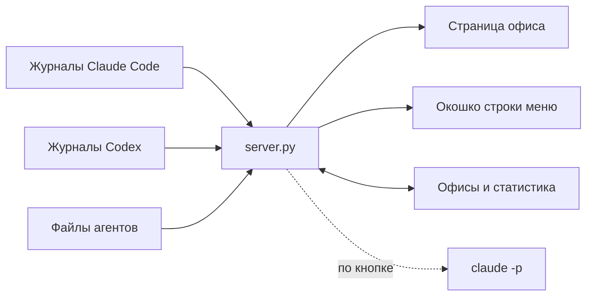

```
server.py           сервер: разбор журналов, стоимость, офисы, API
web/index.html      страница
web/floors.js       отрисовка офиса (собирается из src/, лежит в репозитории)
web/menubar.html    окошко строки меню
src/floors.ts       исходник отрисовки: холст, кадр за кадром
src/office.ts       имена ролей и деньги
src/shot.ts         названия скриншотов и PNG
src/menubar.ts      исходник окошка, графики на SVG
menubar/            приложение для строки меню (Swift, один файл)
scripts/            сборка приложения, автозапуск
tests/              тесты сервера (unittest)
examples/           пример файла офиса
docs/screenshots/   картинки для README, сняты на вымышленных данных
```

## Как ведётся разработка

Проект делается вместе с агентами, правила лежат в репозитории: [AGENTS.md](AGENTS.md) читают и Codex, и Claude Code, [скилы](.claude/skills) подхватываются сами. Копия для Codex в `.agents/skills`.

| Скил | Когда | О чём |
|---|---|---|
| [`karpathy-guidelines`](.claude/skills/karpathy-guidelines/SKILL.md) | Код и ревью | Думать до кода, простота, точечные правки, проверяемая цель |
| [`tdd`](.claude/skills/tdd/SKILL.md) | Фича или багфикс | Сначала падающий тест, тесты не подгоняются под код |
| [`git-workflow`](.claude/skills/git-workflow/SKILL.md) | Ветка, коммит, PR | Имена веток, Conventional Commits, squash |
| [`readme-sync`](.claude/skills/readme-sync/SKILL.md) | Перед пушем | Какой раздел README проверить при какой правке |
| [`verify-done`](.claude/skills/verify-done/SKILL.md) | Перед словом «готово» | Проверять результат, а не намерение |
| [`public-repo-hygiene`](.claude/skills/public-repo-hygiene/SKILL.md) | Документы, примеры, скриншоты | Плейсхолдеры вместо личных данных |

`karpathy-guidelines` взят без изменений из [multica-ai/andrej-karpathy-skills](https://github.com/multica-ai/andrej-karpathy-skills), по мотивам [наблюдений Андрея Карпати](https://x.com/karpathy/status/2015883857489522876).

Скилы можно забрать себе: скопируйте `.claude/skills` в свой проект и поправьте команды.

## Лицензия

[MIT](LICENSE)
